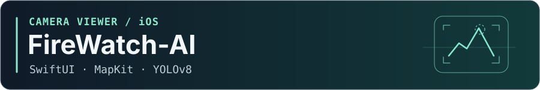
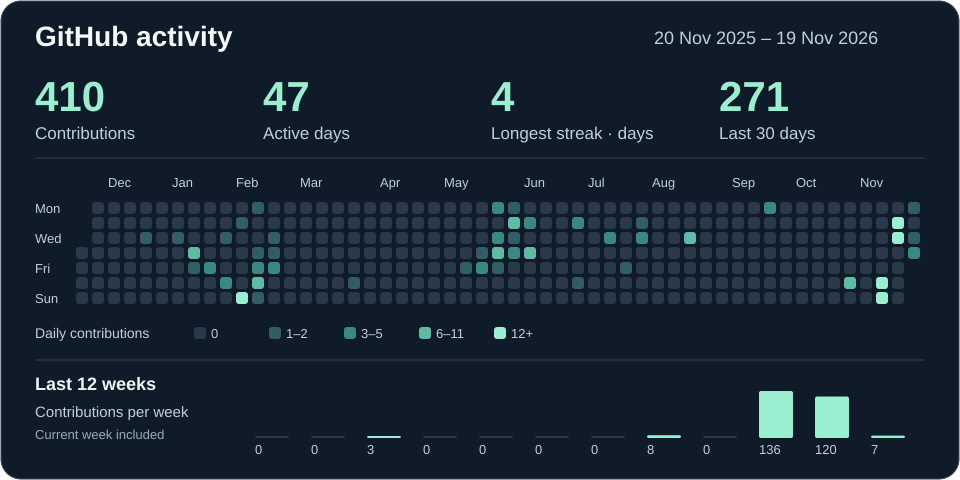

## Featured projects

<a href="https://github.com/Alizhan-T/FireWatch-AI"></a>

**FireWatch-AI** brings a map of camera locations in Kazakhstan and an HLS player into one iPhone app. Camera viewing runs directly on the phone. An optional FastAPI service runs YOLOv8 fire and smoke inference.

[Explore the source ↗](https://github.com/Alizhan-T/FireWatch-AI) · [iOS setup ↗](https://github.com/Alizhan-T/FireWatch-AI/tree/main/FireWatchNative)


**ALIZH-PROCTORING** brings the curator and student sides of an online exam into one demo. Curators can build an exam with a validated form. Students can check their camera and microphone and try the timed exam flow. The dashboard uses demo data.

**Project stage** · Interface prototype with private source.

## Engineering notes

```swift
enum FireWatch {
    static let playback  = "AVPlayer"    // Stream HLS on the device
    static let locations = "MapKit"      // Find the camera on a map
    static let inference = "FastAPI"     // Run YOLOv8 on the optional server
}
```

## Stack

<p>
  &nbsp;
  &nbsp;
  &nbsp;
  &nbsp;
  &nbsp;
  
</p>

Swift · Python · FastAPI · TypeScript · Next.js · Tailwind CSS

## Activity



[Contribution history ↗](https://github.com/Alizhan-T?tab=overview#js-contribution-activity) · [Public repositories ↗](https://github.com/Alizhan-T?tab=repositories)
