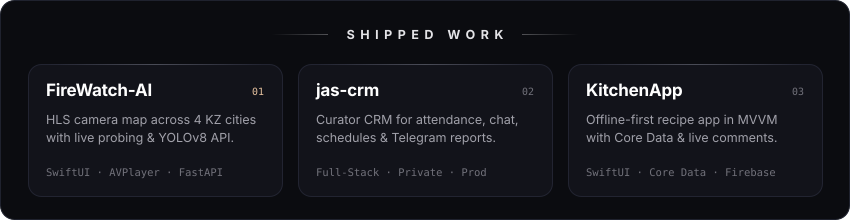
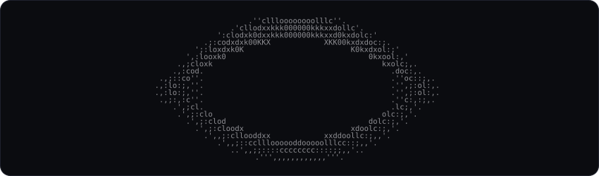

  

  

  

  <a href="https://github.com/Alizhan-T/FireWatch-AI">FireWatch-AI ↗</a> &nbsp;·&nbsp;
  <a href="https://github.com/Alizhan-T/KitchenApp">KitchenApp ↗</a> &nbsp;·&nbsp;
  <a href="https://github.com/Alizhan-T/MultiverseWiki">MultiverseWiki ↗</a> &nbsp;·&nbsp;
  <a href="https://github.com/Alizhan-T/alizhmarket">ALIZHMARKET ↗</a> &nbsp;·&nbsp;
  <a href="https://alizhan-t.github.io/">Portfolio ↗</a>

  

  

